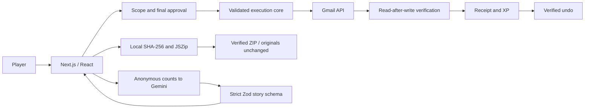

# QuestOS submission kit

## 90-second pitch

Digital chores are small enough to postpone and repetitive enough to pile up. QuestOS turns them into short adventures that produce real digital work.

In Inbox Kingdom, you scan a small batch of old promotions, review the recommendations, and approve the quest scope. During play, one key archives, one labels, and one keeps. You inspect the exact choices before execution. QuestOS performs the approved Gmail operations, reads the messages again to verify them, and grants XP only after verification. Undo restores the targeted labels and reverses XP.

In File Forest, your files stay on your device. We hash their contents, detect exact duplicates, and show every destination before you approve. Complete the sorting trail and download a verified ZIP with a manifest. Every original is untouched.

This is demonstrated, not just planned. Our live test signed into Google, refreshed access, retrieved twelve real candidates, archived one authorized message, verified it, and restored it. The file flow produces an actual archive. The public sample inbox is clearly labeled simulated.

Gemini is an optional story writer; it cannot execute chores. When it is unavailable, built-in stories keep the experience running. Current recommendations use conservative rules.

We would start with students and professionals who postpone digital admin, validate repeat usage, then test a modest paid plan for additional connected workflows. QuestOS: play the game, clear the chaos.

## Three-minute live demo

**0:00–0:20:** Open the landing page. State: “Your game choices become authorized operations.” Enter the labeled sample demo.

**0:20–1:10:** Inbox Kingdom → Scan → inspect recommendations → approve scope → 1 archive, 2 label, 3 keep → final review → approve **demo** cleanup. Say clearly that this mailbox is simulated. Show the receipt and undo.

**1:10–2:10:** File Forest → six samples or a prepared fixture batch → point out the duplicate → approve → sort → approve download → open ZIP and manifest. These are real generated files, and originals remain unchanged.

**2:10–2:40:** On the prepared local authenticated workspace, show the already verified live archive/undo receipt. Only run another real operation with fresh explicit authorization. Explain the server approval and read-after-write checks.

**2:40–3:00:** Show achievements and architecture. Close: “A small game. A real authorized operation. A result you can inspect.”

## Backup demo

Use the public sample inbox and browser-local sample files. Label Gmail **simulated** verbally and on screen. File ZIP generation remains real. Keep the local production server running for offline-with-local-assets fallback. Private live email screenshots are not in the public repository. Never claim a recording or sample receipt is a fresh live execution.

## Architecture

Google tokens are encrypted in HttpOnly cookies. Local live-demo plans/receipts use isolated SQLite. Supabase is an optional configured backend; the existing projects are untouched. Public hosting must not pretend ephemeral filesystem storage is durable. Gemini has no tools, task IDs, email content or file bytes.

## Differentiation and competitor comparison

| Approach | Main interaction | QuestOS distinction |
|---|---|---|
| Habitica | Gamified task/habit tracking and rewards | QuestOS decisions map to actual Gmail deltas and generated ZIP entries |
| Gmail native interface | Direct archive, labels and inbox management | QuestOS adds a playable batch, approval boundary and application receipt/undo |
| File manager / ZIP utilities | Direct file organization and archives | QuestOS adds an approved sorting game, content hashes and an all-input manifest |

This is a narrow positioning comparison, not a claim that competitors have no integrations or automation. Sources: [Habitica features](https://habitica.com/static/features), [Google archive help](https://support.google.com/mail/answer/6576). No fabricated market-size or traction numbers.

## Business hypothesis

Start with students and knowledge workers who already experience email/file clutter. Validate a second completed quest within seven days, actual verified items per session, undo rate, and willingness to pay. Free entry: demo and browser-local files. Test **₹199/month**, explicitly an unvalidated hypothesis, for connected realms and saved workflows after production readiness. Team plans are future research, not an existing product. Keep file processing local to reduce infrastructure costs; measure model and database costs before promising margins. No revenue, customer or conversion claims are made.

## Fifteen judge questions

1. **Does it do real work?** Yes. One authorized live Gmail archive and restoration were verified; the ZIP flow creates real files.
2. **Is the public inbox live?** The public sample inbox is simulated and labeled. The local configured account demonstrated real operations.
3. **What does AI do?** Optional narrative generation from anonymous counts. Cleanup recommendations currently use deterministic rules.
4. **What if Gemini fails?** Two bounded attempts, schema checks and deterministic fallback. Real operations do not depend on model success.
5. **Can AI delete mail?** No model execution tools exist. The app exposes archive and label only, never message deletion or sending.
6. **When is approval obtained?** Before play for scope and again for the exact chosen mutations before execution.
7. **What happens after a network failure?** Targets are recorded first. Partial outcomes receive no XP; undo reconciles recorded deltas.
8. **Can a double click execute twice?** The server claims a plan atomically and uses one unique receipt. Concurrent/retry fixtures verify this.
9. **How does undo work?** Restore INBOX only where the quest removed it and remove only labels the quest added; re-read Gmail to verify.
10. **Are originals modified?** No. Browser File objects are read; a new ZIP is created. Discarding the ZIP reverses the organization outcome.
11. **How are duplicates detected?** Exact SHA-256 content hashes; not filenames, approximate similarity or semantic equivalence.
12. **Are rewards cheat-proof?** No. Local/demo progress is for motivation. Competitive anti-cheat and shared leaderboards are not implemented.
13. **Why not just use Gmail?** Gmail executes operations directly. QuestOS tests whether a short playable, verifiable workflow makes postponed batches easier to finish.
14. **How would you make money?** Validate repeat usage, then test a modest subscription for more connected workflows. Pricing is hypothetical.
15. **What is unfinished?** Reliable live AI output, durable hosted live storage/production OAuth and public-launch hardening. Expense Empire and Code Citadel are future worlds.

## Demo preflight

- Start local production server; verify landing, sample demo, ZIP and receipt.
- Keep a small known fixture batch. Avoid private files on a projector.
- Confirm browser download destination before presenting.
- Never broaden an email scan or act on extra mail to rescue a demo.
- If a provider fails, switch to labeled samples and explain the boundary.
